# MEI's @notationtype and @notationsubtype

MEI encodes flavour of Mensural notation at `<staffDef>`'s `@notationtype` attribute. In MEI 5.1 and 6.0-dev defines [values](https://music-encoding.org/guidelines/dev/mei-mensural/data-types/data.NOTATIONTYPE.html):
* `"mensural"`
* `"mensural.black"`
* `"mensural.white"`

Additionally, MEI provides `@notationsubtype` attribute allowing for additional free description.

We see that this attribute, rightly so, is used e.g. by Verovio to adjust the visual aspects of the score. It provides a clue for _what visual features needs to be engaged to express durational value of a note_.

This GitHub issue proposes to extend coverage of `@notationtype` values to more types of mensural notation based on existing repertoire.

# Prelimianry literature

I base my terminology on the following sources:

* M. Bent, _Principles of mensuration and coloration: virtuosity and anomalies in the Old Hall manuscript_.

* P. Kolb, Divisions of dots and dots of division: history, theory, and practice

# Example sources

The following examples show different flavours of what could be encoded using `@notationtype`.

| Century | Source | Notation |
|:----:|:------:|:--------:|
| XIV | [Tournai](https://www.diamm.ac.uk/sources/7/) p. 1 | 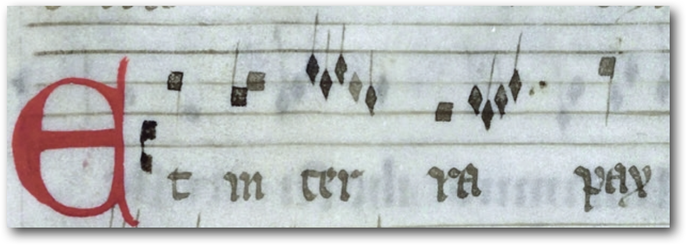 |
| XIV | [Chantilly](https://www.diamm.ac.uk/sources/201/) f. 44 | 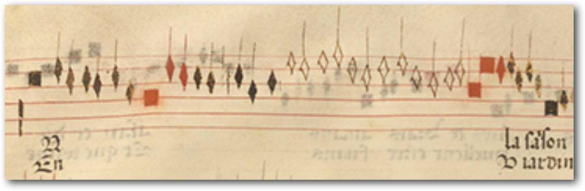 |
| XV | [I-Bc Q15](https://www.diamm.ac.uk/sources/117/) f. 169v | 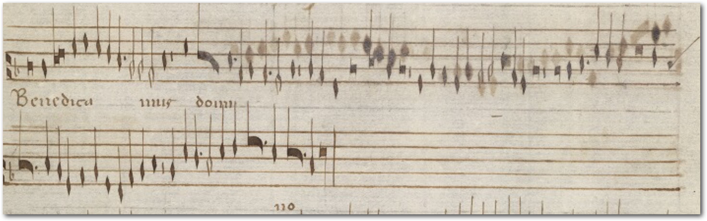 |
| XV | [Trent 87](https://www.diamm.ac.uk/sources/807/) f. 219v | 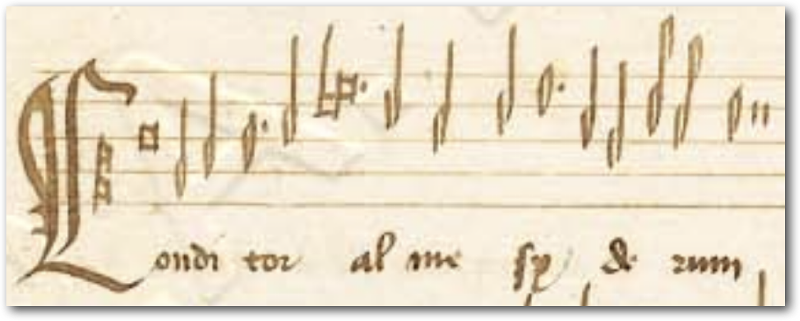 |
| XV | [Old Hall](https://www.diamm.ac.uk/sources/210/#/images) f. 44 | 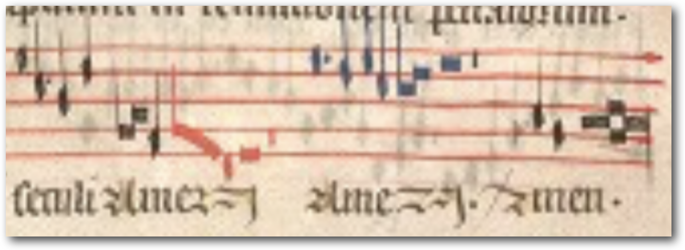 |
| XV | [Aosta](https://www.diamm.ac.uk/sources/112/) f. 232 | 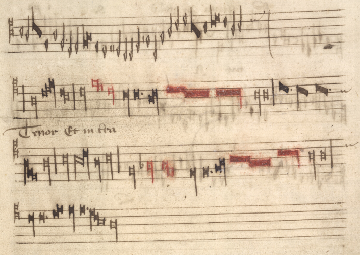 |
| XV | [Chigi](https://www.diamm.ac.uk/sources/943/) f. 104 | 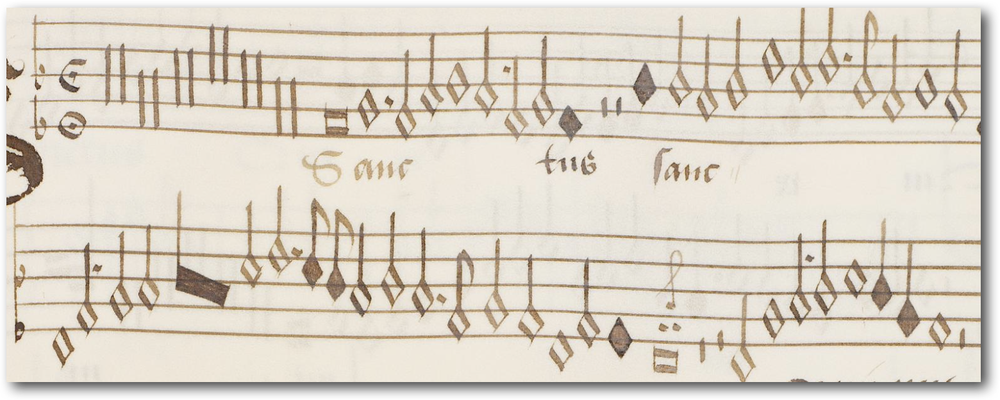 |
| XVI | [Ed. Attaignan](https://ks15.imslp.org/files/imglnks/usimg/a/ab/IMSLP64609-PMLP131631-AttaignantOrgue.pdf) p. 2 | 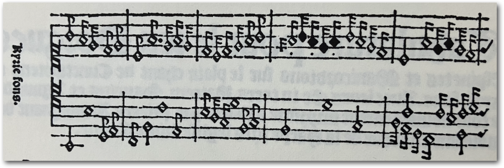 |
| XVII | [Frescobaldi](https://ks15.imslp.org/files/imglnks/usimg/d/db/IMSLP304590-PMLP181690-Frescobaldi_-_Fiori_Musicali_-Alessandro_Vincenti,_1635-.pdf) p. 92 | 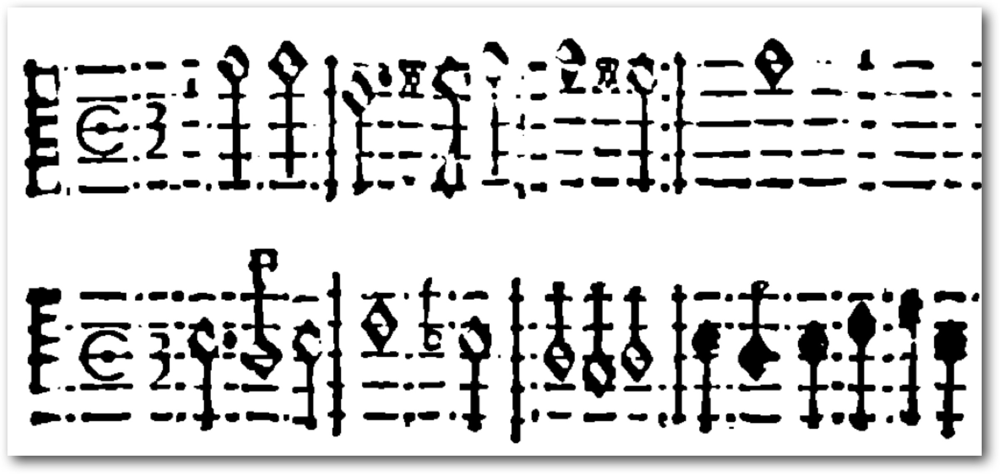 |

> [!tip]
> Please suggest more!

# Logical features of mensural rhythm

The following section brings a selection of logical information. This information is encoded using various visual clues, depending on the notation going much beyond the \"white- vs black-\" mensural distinction.

### Durational Value Sequence (DVS) 

| `@notationtype` | expected DVS (lilypond) | Verovio 6.3.0 |
|:---------------:|:------------:|:-------------:|
| `cmn`           | 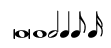 | 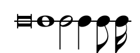 |
| `mensural`      | 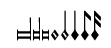 |  |
| `mensural.white`      |  | 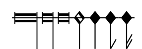 |
| `mensural.black`      | 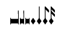 | 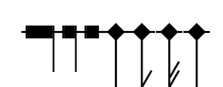 _(semifusa renders incorrectly)_ |

A *durational value* [^1] (short: \"**value**\") is a *logical* property of a note that indicates the note's position in an ordered sequence of progressively finer durational values (short: \"**DVS**\").

DVS is expressed using the visual features:
* *shape* (breve, whole, half)
* *fill* (half, quarter)
* *flags* amount (quater, 8th, 16th...)

In Common Music Notation, each value consists of two smaller values. In mensural notation, those complexities are govern by the **mensura**. 

### PROPOSAL 1 – void notation

The void notation (term after Bent) works similar to black notation except all notes are not filled. It can be found in XV c. as well as in early XVI prints.

This notation is often conflated with XVI c. white mensural notation. However, it is behaves more like a black notation's subtype with colors reversed.

**Unlike _white_** notation, the polychrome version of the void notation uses different pigment-coding for mensural `color` (see next section).

**Unlike _black_** notation, it may contain opposite-filled noteheads denoting smaller durations values. Those minute values appear rarely in XV, but more often in XVI century.

| Notation | expected DVS (lilypond) | examples | comment |
|:--------:|:-----------------------:|:-------:|:-------:|
| `mensural.void` | 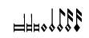 |   | Where exactly duple proportion is encoded? Only when second flag appears?

> [!caution]
> Is there any example where notes become black after addition of the first flag?
> 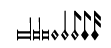
> This appears in white mensural notation (sic!) when mensura has `prolatio maior`. See further example with Ockeghem.

### PROPOSAL 2 – monochrome vs polychrome

Those terms come from M. Bent, _Principles of mensuration and coloration: virtuosity and anomalies in the Old Hall manuscript_.

Mensural notation can use additional pigment denoting a mensural `color`. It allows to mark two categories of mensural operations:
* imperfection, sesquialtera or \"color minor\"
* duple proportion

Understanding the meaning of color depends heavily on what kind of mensural notation is applied. Thus, application of color should be at least mentioned in MEI documentation. 

| Feature | ex. | default | color | duple |
|:-:|:-:|:-:|:-:|:-:|
| black monochrome (./older) |  | ⚫ | — | — |
| black polychrome |  | ⚫ | 🔴 🔵 | ⚪ ⭕ |
| black monochrome (./decolorized) |  | ź | ⚪ | ⚪ |
| void |  | ⚪ | ⚫ | ⚫? |
| void polychrome | 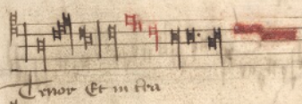 | ⚪ | ⭕ | ⚫ 🔴 |
| "white" | 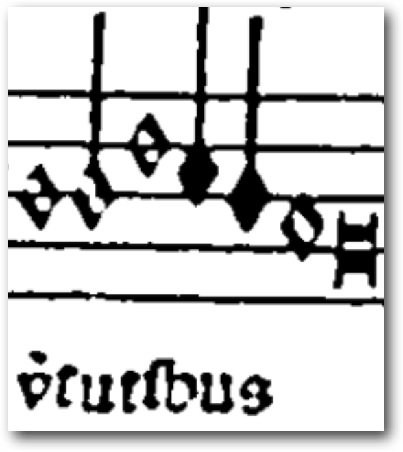 | ⚪⚫ | ⚫ | — |

Note:
* Black monochrome appears here twice. The "older" version was suitable for pieces from before rhythmic of late XIV c. The "decolorized" version is a type of notation where advanced mensural features (like duple void proportion) are used but using pigment is avoided.
* blue notation 🔵 appears exclusively in Old Hall codex.
* Void polychrome notation is very rare and is usually a result of a transcription (see Bent's remarks on Aosta manuscript).

### ISSUE – encoding white mensural prolatio maior – add to guidelines!

`Prolatio maior` notation retains many old spelling idioms. Consider this example:

Here, two concurrent DVS are used:
||||
|:-:|:-:|:-:|
| 1. |  | Stemmed void semiminims are void and appear after dotted minims. |
| 2. |  | Semiminims are filled and stemless.

This idiom can be well-found still even in XVII century:

How DVS is represented vary greatily depending on notation:

|  | ex. | DVS |
|:-:|:-:|:-:|
| black monochrome (./older) |  |  |
| black monochrome |  | 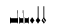 |
| void |  |  |
| "white" |  |  |

## Dots

Mei has:
* augmentationis
* divisionis

Why not also:
* perfectionis, imperfectionis, alterationis, syncopationis, additionis (Tinctoris)
* transportationis (Gaffurius)

# Footnotes

[^1]: Two terms are used within MEI documentation:
1) [data.DURATION.mensural](https://music-encoding.org/guidelines/dev/mei-mensural/data-types/data.DURATION.mensural.html)
2) [B4 Repertoire: Mensural Notation](https://music-encoding.org/guidelines/dev/mei-mensural/content/mensural.html#mensuralRules) guideline uses term \"degree\" is used (e.g. \"next smaller degree\")
